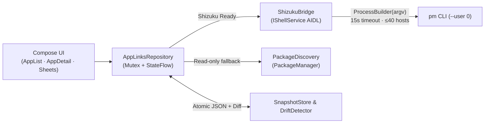

# FlipLink

Android utility (`dev.miles.fliplink`) that restores per-domain **Open by default** link control on Android 12+ OEM ROMs (such as Honor MagicOS) where system settings hide per-domain toggles and leave web links disabled by default.

Built as a flat, high-density system instrument: no background services, no root (`su`), and no Share-sheet or browser-interception workarounds—just direct control over Android's native `pm` domain-verification layer.

---

## Screenshots

<table>
  <tr>
    <td align="center"><br /><sub>App List (Light)</sub></td>
    <td align="center"><br /><sub>App List (Dark)</sub></td>
    <td align="center"><br /><sub>Conflict Takeover</sub></td>
    <td align="center"><br /><sub>Drift Review</sub></td>
  </tr>
</table>

---

## Why FlipLink

On several Android 12+ OEM ROMs, the system **Open by default** screen only exposes the master *Open supported links in this app* switch while hiding the per-domain host list. FlipLink brings that control back and handles two real-world edge cases:

1. **Non-`autoVerify` & patched apps:** Apps installed outside Google Play or patched with a different signing key cannot pass Digital Asset Links verification. Android leaves their domains disabled until explicitly enabled via `user-selection`, and a `verified` stock app will still win every link click unless its conflicting domains are demoted.
2. **System update drift:** OEM updates and app reinstalls can silently reset domain selections or re-verify a demoted stock app. FlipLink snapshots your applied choices locally and flags exact deltas for one-tap re-application.

---

## Key Capabilities

- **Searchable App List:** Filters installed web-link apps by app name, package name, or declared domain host (`All`, `Needs attention`, `Conflicts`, `Configured`, plus an independent `System` toggle).
- **Per-Domain Control:** Master link-handling switch, `Enable all` / `Disable all`, and per-host toggles backed by live `pm get-app-links --user 0` re-reads.
- **One-Tap Conflict Takeover:** Detects overlapping domain claims across installed apps, demotes competing owners per-domain (`STATE_DENIED` + `user-selection false`) without touching their master switch or unrelated domains, promotes your chosen app, and offers `Undo`.
- **Read-Only & `adb shell` Fallback:** When Shizuku is not running, FlipLink still discovers declared `http`/`https` hosts (`Declared` status) and generates sanitized, copyable `adb shell pm ...` commands.
- **Drift Detection & Config Backup:** Tracks applied selections and demoted competitors in `fliplink_snapshot_v1.json`, surfaces a compact drift review sheet when OS state diverges, and supports JSON export/import via Android's Storage Access Framework.
- **Theming:** `System`, `Light`, `Dark`, and `AMOLED Black` (`#000000`) surfaces with opt-in Material You Dynamic Color.

---

## How It Works



### Status Pill Grammar

| Pill | Meaning |
| :--- | :--- |
| **Verified** | OS cryptographic Digital Asset Links verification (`STATE_SUCCESS` / pre-verified) |
| **Approved** | Explicitly approved via `pm set-app-links` (`STATE_APPROVED`) |
| **Selected** | User-selected host (`pm set-app-links-user-selection ... true`) |
| **Disabled** | Host is declared but inactive / unselected |
| **Denied** | Explicitly denied (`STATE_DENIED`)—used when demoting a competing app |
| **Declared** | Read-only mode (Shizuku unavailable); host is declared in the app's manifest |

---

## Requirements & Scope

- **OS:** Android 12+ (`minSdk = 31`, `targetSdk = 35`)
- **Privilege:** [Shizuku](https://shizuku.rikka.app/) for in-app mutations (optional; read-only inspection and copyable `adb` commands work without Shizuku)
- **Scope:** Single-user (`--user 0`) only. Root (`su`), background install-watching services, multi-user/clone profiles, and Share-sheet interception are intentionally out of scope.

---

## Installation

Download the signed release APK (`FlipLink-v*.apk`) from [GitHub Releases](https://github.com/miles2542/FlipLink/releases) and install it on your device.

If Shizuku is installed and running, grant FlipLink permission when prompted (or from the top-bar status pill) to enable in-app toggling.

---

## Building from Source

Requires **JDK 21** and Android SDK (`compileSdk = 36`, `build-tools;36.0.0`).

```bash
# Run JVM unit tests and build debug APK
./gradlew testDebugUnitTest assembleDebug

# Build R8-minified release APK (falls back to debug signing unless signing.properties is provided)
./gradlew testDebugUnitTest assembleRelease
```

---

## License

MIT — see [LICENSE](LICENSE).
